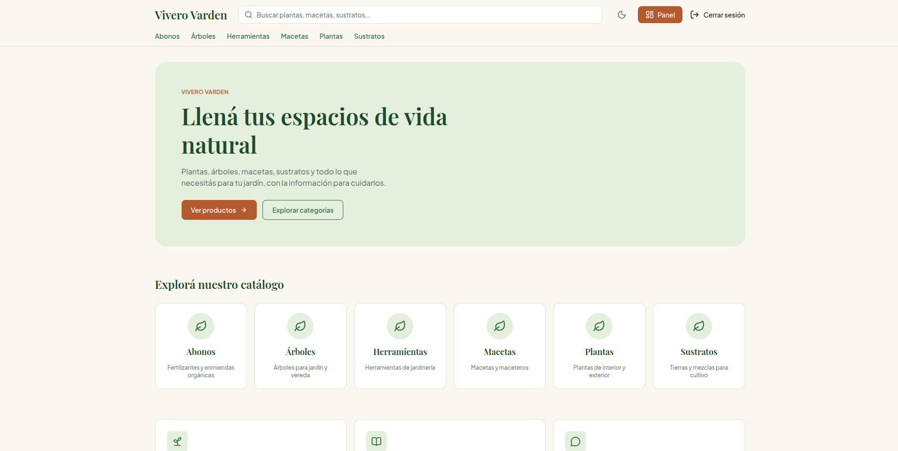
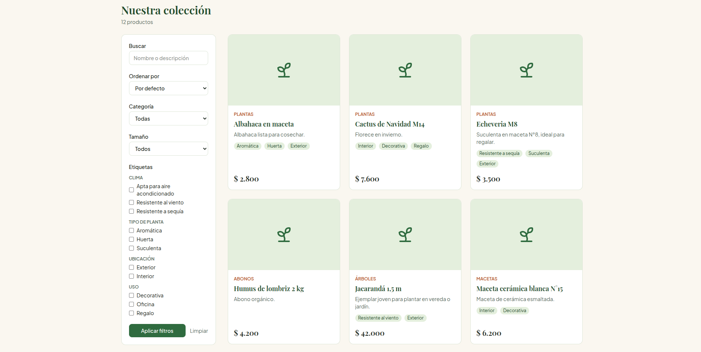
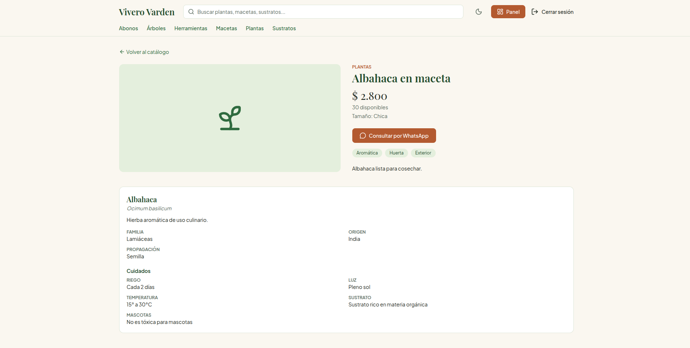
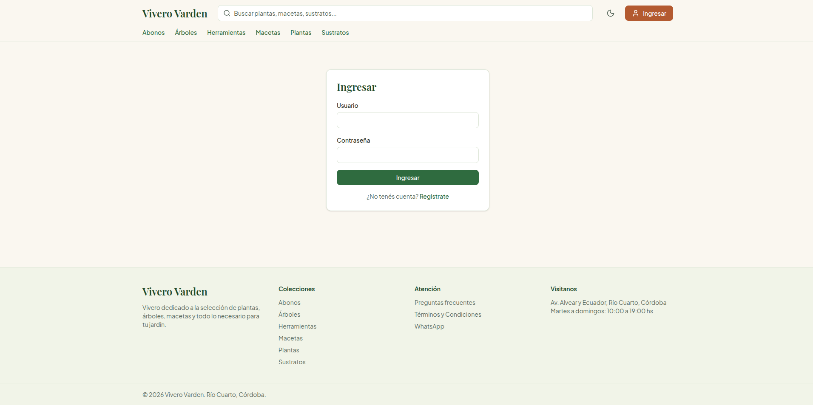
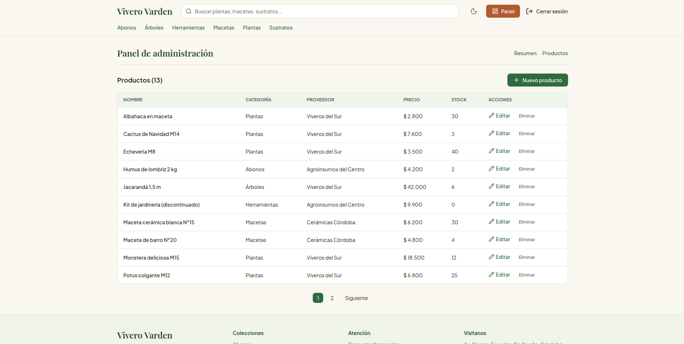
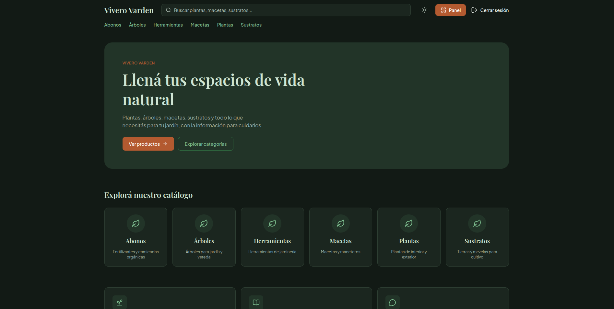

# Vivero Varden - Frontend

Aplicación web de **Vivero Varden**, un vivero que vende plantas, árboles, macetas y sustratos. El sitio permite recorrer el catálogo con búsqueda y filtros, ver la ficha de cada producto con la información de su especie y su guía de cuidados, dejar comentarios y consultar por WhatsApp. El personal del vivero administra los productos desde un panel protegido.

Es el frontend del Examen Final Integrador de **Programación III** (Tecnicatura Superior en Desarrollo de Software, ITEC Río Cuarto, 2026). Consume la API REST desarrollada para Ingeniería de Software:

- **Repositorio del back:** https://github.com/facundo-puig/Vivero-Varden
- **Documentación de la API (Swagger):** https://vivero-varden-api.onrender.com/api/docs/

## Aplicación desplegada

https://vivero-varden-front.vercel.app

> La API del back está en el plan gratuito de Render: si estuvo inactiva, la primera carga puede tardar hasta un minuto.

## Integrantes

- Facundo Puig

## Tecnologías

Next.js 16 (App Router) · React 19 · JavaScript · Tailwind CSS 4 · React Hook Form · Zod · lucide-react · Vitest y Testing Library

## Cómo ejecutarlo en local

Requisitos: Node.js 20 o superior y Git.

```bash
git clone https://github.com/facundo-puig/Vivero-Varden-Front.git
cd Vivero-Varden-Front
npm install
cp .env.example .env.local
npm run dev
```

La aplicación queda en http://localhost:3000.

### Variables de entorno

| Variable | Qué es | Ejemplo |
|---|---|---|
| `NEXT_PUBLIC_API_URL` | URL base de la API del back, sin barra al final | `https://vivero-varden-api.onrender.com` |

Para usar un back local (con Docker, ver el README del back) se pone `http://localhost:8000`.

En Vercel, la variable se carga en **Settings → Environment Variables**.

> El panel de administración (`/dashboard`) solo lo ve un usuario staff. Se crea desde el back con `createsuperuser`. Los usuarios que se registran desde el sitio son clientes comunes.

## Tests

```bash
npm test
```

Ejecuta 11 tests unitarios con Vitest: validaciones Zod (login y producto), utilidades de productos (`formatearPrecio`, `armarPayloadProducto`), el componente `EstadoVacio` y el Context del tema.

## Capturas

| Inicio | Catálogo |
|---|---|
|  |  |

| Detalle de producto | Login |
|---|---|
|  |  |

| Panel de administración | Modo oscuro |
|---|---|
|  |  |

## Rutas

| Ruta | Descripción | Acceso |
|---|---|---|
| `/` | Inicio: categorías y productos destacados | Público |
| `/productos` | Catálogo con búsqueda, filtros, orden y paginación | Público |
| `/productos/[id]` | Detalle, guía de cuidados y comentarios | Público (comentar requiere sesión) |
| `/login` | Inicio de sesión | Público |
| `/registro` | Crear cuenta | Público |
| `/preguntas-frecuentes` | Preguntas frecuentes | Público |
| `/terminos-y-condiciones` | Términos y condiciones | Público |
| `/dashboard` | Resumen del panel | Staff |
| `/dashboard/productos` | Listado de productos con acciones | Staff |
| `/dashboard/productos/nuevo` | Alta de producto | Staff |
| `/dashboard/productos/[id]/editar` | Edición de producto | Staff |

Hay `loading.jsx`, `error.jsx` y `not-found.jsx` en el catálogo, el detalle y el panel. El panel tiene además su propio `layout.js` anidado que verifica la sesión.

## Estructura del proyecto

```
src/
├── app/                  Rutas (App Router) y Server Actions (actions.js)
│   └── validations/      Esquemas Zod (login, registro, producto, comentario)
├── components/
│   ├── layout/           Navbar, Footer, BotonTema
│   ├── ui/               EstadoVacio, Paginacion, PaginaTexto, BotonEliminar
│   ├── auth/             FormularioLogin, FormularioRegistro
│   ├── productos/        TarjetaProducto, FiltrosProductos, CuidadosEspecie,
│   │                     BotonWhatsapp, FormularioComentario, ListaComentarios
│   ├── dashboard/        FormularioProducto, TablaProductos
│   └── inicio/           TarjetaCategoria
├── context/              TemaContext (Context API)
├── lib/                  api.js (cliente de la API), auth.js (sesión), productos.js
└── __tests__/            Tests con Vitest
```

## Decisiones de diseño

**Server y Client Components.** Todo lo que solo muestra datos es Server Component, porque consulta la API desde el servidor y no envía JavaScript al navegador (`Navbar`, `Footer`, `TarjetaProducto`, `EstadoVacio`, `Paginacion`, `CuidadosEspecie`, las páginas). Son Client Components los que necesitan estado, eventos o el navegador: los formularios (React Hook Form), `BotonEliminar` (confirmación en dos pasos), `BotonTema` y `TemaContext` (Context API y `localStorage`).

**Autenticación.** El login obtiene el token JWT de la API (`/api/auth/login/`) y lo guarda en una cookie `httpOnly` con la misma duración que el token (60 minutos). El navegador nunca lee el token. Las rutas del panel se protegen en su layout: sin sesión redirigen a `/login`, y si el usuario no es staff, al inicio.

**Llamadas a la API desde el servidor.** Las lecturas se hacen en Server Components y las escrituras (crear, editar, borrar, comentar, login, registro) con Server Actions, que agregan el token. Por eso el navegador no habla directo con la API y no hace falta configurar CORS.

**Formularios.** React Hook Form con Zod (`zodResolver`). Se muestran los errores de validación en cada campo y los errores que devuelve la API (credenciales inválidas, usuario repetido, etc.).

**Estado global.** `TemaContext` (`createContext` y `useContext`) comparte el tema claro/oscuro. La elección se guarda en `localStorage` y se aplica con la clase `dark` de Tailwind.

**Compra por WhatsApp.** El back ya soporta pedidos, pero el sitio resuelve la compra con un botón "Consultar por WhatsApp" en cada producto, con un mensaje prearmado. Evita un carrito completo, que excede el alcance de la consigna.

## Tablero Kanban
https://trello.com/b/c6AJ0COB/vivero-varden-front

## Proceso de trabajo

Se usó GitFlow: ramas `main`, `develop` y ramas `feature/*` (más `fix/*` y `refactor/*`), con commits descriptivos y un pull request por cada funcionalidad.